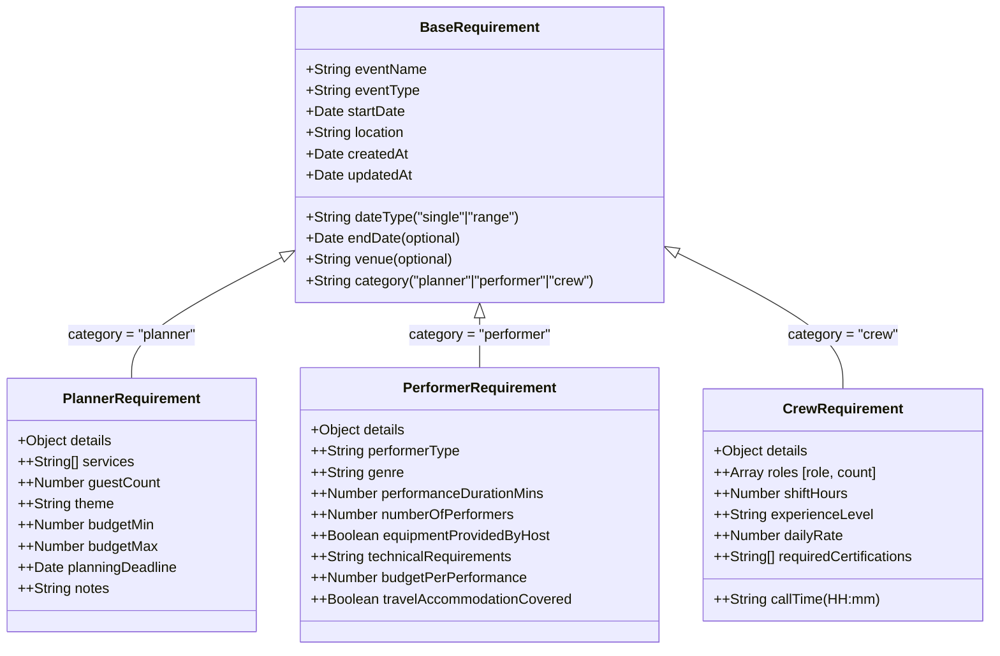

# GoPratle – Multi-Step Requirement Posting Flow

A production-grade, full-stack multi-step requirement posting application for event organizers. Users can post structured event requirements across three distinct professional categories: **Event Planner**, **Performer**, and **Crew & Tech**. The wizard dynamically adapts downstream fields, validates each step with strict schemas, persists progress locally across reloads, and stores submissions in a single polymorphic MongoDB collection.

---

## Live Demo

- **Frontend Application (Vercel):** `https://<your-vercel-app>.vercel.app`
- **Backend API Service (Render):** `https://<your-render-app>.onrender.com`
- **Backend Health Check:** `https://<your-render-app>.onrender.com/health`

> **Note on Render Free Tier Cold Starts:** The backend is deployed on Render's free web service tier. If the instance has been idle, the initial request may take ~30–50 seconds for the container to wake from sleep. Subsequent requests will respond with standard low latency.

---

## 1. Project Overview

- **Frontend:** Next.js 16 (App Router), React 19, TypeScript, Tailwind CSS, React Hook Form + Zod, Zustand with `sessionStorage` persistence.
- **Backend:** Node.js, Express, TypeScript, Mongoose (MongoDB Atlas), Zod discriminated union validation, Helmet, CORS.
- **Testing:** 
  - Backend: Jest + Supertest with `mongodb-memory-server` (18 passing tests).
  - Frontend: Vitest + React Testing Library + `@testing-library/jest-dom` (13 passing tests).
- **Architecture:** Monorepo containing decoupled `frontend/` and `backend/` packages with isolated dependencies.

---

## 2. Architecture & Monorepo Structure

```
/
├── README.md                      # Comprehensive project documentation
├── DECISIONS.md                   # Architectural decisions, trade-offs, and design rationale
├── IMPLEMENTATION_PLAN.md         # Detailed specification & execution plan
├── backend/                       # Express + TypeScript API service
│   ├── src/
│   │   ├── app.ts                 # Express application setup & middleware (Supertest-ready)
│   │   ├── index.ts               # HTTP server lifecycle, DB connection & port binding
│   │   ├── config/db.ts           # Mongoose connection with fast-fail & reconnection diagnostics
│   │   ├── models/                # Polymorphic Mongoose models with discriminators
│   │   │   └── Requirement.ts     # BaseRequirement, PlannerRequirement, PerformerRequirement, CrewRequirement
│   │   ├── schemas/               # Zod validation schemas (discriminated union on category)
│   │   │   └── requirement.schema.ts
│   │   ├── controllers/           # Request handlers for POST, GET list, and GET by ID
│   │   │   └── requirement.controller.ts
│   │   ├── routes/                # API route definitions
│   │   │   └── requirement.routes.ts
│   │   ├── middleware/            # Zod validation, fast-fail DB guard (503), central error handler
│   │   │   ├── validate.ts
│   │   │   └── errorHandler.ts
│   │   └── tests/                 # End-to-end integration test suite
│   │       └── requirement.test.ts
│   ├── samples/                   # Sample JSON payloads for testing
│   ├── package.json
│   ├── tsconfig.json
│   └── .env.example
└── frontend/                      # Next.js 16 (App Router) client application
    ├── app/
    │   ├── page.tsx               # Landing hero with quick links and category overview
    │   ├── post-requirement/      # 4-step wizard page
    │   │   ├── layout.tsx         # Page metadata (<title>Post a Requirement – GoPratle</title>)
    │   │   └── page.tsx           # Hydrated wizard shell
    │   ├── requirements/          # Public requirement feed with category filtering tabs
    │   │   ├── layout.tsx         # Page metadata (<title>Event Requirements Feed – GoPratle</title>)
    │   │   └── page.tsx           # Category tabs, pagination, status badges
    │   ├── icon.svg               # GoPratle brand SVG favicon
    │   ├── layout.tsx             # Root layout with responsive styling
    │   └── globals.css            # Tailwind CSS design system tokens
    ├── components/
    │   ├── wizard/                # Wizard shell, progress stepper, review step, success screen, modal
    │   │   ├── Stepper.tsx
    │   │   ├── StepShell.tsx
    │   │   ├── ReviewStep.tsx
    │   │   ├── SuccessScreen.tsx
    │   │   └── CategoryChangeModal.tsx
    │   └── steps/                 # Category-specific step forms
    │       ├── EventBasics.tsx    # Step 1: Base event metadata + category selector
    │       ├── planner/           # Step 2 (Scope & Services), Step 3 (Budget & Timeline)
    │       ├── performer/         # Step 2 (Act Specifications), Step 3 (Budget & Logistics)
    │       └── crew/              # Step 2 (Dynamic Roles List), Step 3 (Hours, Rate, Certs)
    ├── store/
    │   └── wizardStore.ts         # Zustand store with sessionStorage persistence & safe rehydration
    ├── lib/
    │   ├── api.ts                 # Typed API client, ApiError class, and error mapping
    │   ├── schemas.ts             # Per-step granular Zod schemas & options
    │   ├── stepConfig.ts          # Declarative map routing categories to Step 2/3 components
    │   ├── payload.ts             # Strict payload builder & sanitizer (strips single-date endDate, empty strings)
    │   └── formatters.ts          # INR currency and localized date formatting utilities
    ├── __tests__/                 # Vitest + RTL frontend test suite
    │   └── wizard.test.tsx
    ├── package.json
    ├── tsconfig.json
    └── .env.example
```

---

## 3. Data Model & Schema Explanation

### Why Mongoose Discriminators?

The data layer uses **Mongoose discriminators** on a single MongoDB collection named `requirements`, keyed on the `category` property (`planner` | `performer` | `crew`).



#### Key Rationale:
1. **Polymorphic Storage with Single-Query Efficiency:** Common event metadata (`eventName`, `eventType`, `startDate`, `location`, `createdAt`) is indexed uniformly. The `/requirements` feed can fetch, sort, and paginate all requirements in a single query across categories, or filter by category (`{ category }`) using the same compound index `{ category: 1, createdAt: -1 }`.
2. **Schema Integrity per Category:** Unlike a generic unstructured `details: Object` field, each discriminator model (`PlannerRequirement`, `PerformerRequirement`, `CrewRequirement`) enforces strict Mongoose sub-schema rules, required fields, and validation logic.
3. **Avoids Multiple Collections:** Separate collections (`planner_requirements`, `performer_requirements`, etc.) would require complex aggregation pipelines (`$unionWith`) or multiple database round-trips for pagination and global sorting.

---

## 4. Setup & Running Locally

### Prerequisites
- Node.js 20+ (recommended v22.x)
- npm 10+
- MongoDB instance (MongoDB Atlas connection string or local MongoDB on port 27017)

---

### Backend Setup

1. **Navigate to the backend directory and install dependencies:**
   ```bash
   cd backend
   npm install
   ```

2. **Configure environment variables:**
   Copy `.env.example` to `.env`:
   ```bash
   cp .env.example .env
   ```
   Configure the following variables in `.env`:
   ```env
   PORT=5000
   MONGODB_URI=mongodb+srv://<username>:<password>@<cluster>.mongodb.net/gopratle?retryWrites=true&w=majority
   CLIENT_ORIGIN=http://localhost:3000
   ```

3. **Run the backend development server:**
   ```bash
   npm run dev
   ```
   The backend starts at `http://localhost:5000`. Test server health:
   ```bash
   curl http://localhost:5000/health
   # Returns: {"status":"ok","db":"connected"}
   ```

4. **Run backend automated tests:**
   ```bash
   npm test
   ```
   *Runs 18 end-to-end integration tests using in-memory MongoDB (`mongodb-memory-server`) with zero external DB dependencies.*

5. **(Optional) Seed sample requirements into the database:**
   To populate the live database with 6 realistic event requirements (2 per category with realistic INR budgets and Indian cities) before testing or recording:
   ```bash
   npm run seed -- --confirm
   ```
   *Requires the explicit `--confirm` flag to prevent accidental execution.*

---

### Frontend Setup

1. **Navigate to the frontend directory and install dependencies:**
   ```bash
   cd frontend
   npm install
   ```

2. **Configure environment variables:**
   Copy `.env.example` to `.env.local`:
   ```bash
   cp .env.example .env.local
   ```
   Configure `NEXT_PUBLIC_API_URL`:
   ```env
   NEXT_PUBLIC_API_URL=http://localhost:5000/api
   ```

3. **Run the frontend development server:**
   ```bash
   npm run dev
   ```
   Open `http://localhost:3000` in your browser.

4. **Run frontend automated unit & integration tests:**
   ```bash
   npm test
   ```
   *Runs 13 tests with Vitest + React Testing Library verifying validation, category gating, state reset, payload building, and mocked API review submission.*

5. **Run production build verification:**
   ```bash
   npm run build
   ```

---

## 5. API Reference & Sample Payloads

Base Path: `/api`

### 1. `POST /api/requirements`

Creates a new event requirement. Validates the base event metadata and strictly matches the category schema.

#### Category: Event Planner

**Request:**
```http
POST /api/requirements
Content-Type: application/json

{
  "eventName": "TechVision Summit 2027",
  "eventType": "Corporate",
  "dateType": "single",
  "startDate": "2027-09-15",
  "location": "Bengaluru, Karnataka",
  "venue": "Bangalore International Exhibition Centre",
  "category": "planner",
  "details": {
    "services": ["decor", "catering", "AV", "logistics"],
    "guestCount": 650,
    "theme": "Sustainable Modern Minimalist",
    "budgetMin": 500000,
    "budgetMax": 1200000,
    "planningDeadline": "2027-08-01",
    "notes": "Require eco-friendly materials and live hybrid streaming setup."
  }
}
```

**Response (`201 Created`):**
```json
{
  "success": true,
  "data": {
    "_id": "67b9319e349bc9871f3a1290",
    "eventName": "TechVision Summit 2027",
    "eventType": "Corporate",
    "dateType": "single",
    "startDate": "2027-09-15T00:00:00.000Z",
    "location": "Bengaluru, Karnataka",
    "venue": "Bangalore International Exhibition Centre",
    "category": "planner",
    "details": {
      "services": ["decor", "catering", "AV", "logistics"],
      "guestCount": 650,
      "theme": "Sustainable Modern Minimalist",
      "budgetMin": 500000,
      "budgetMax": 1200000,
      "planningDeadline": "2027-08-01T00:00:00.000Z",
      "notes": "Require eco-friendly materials and live hybrid streaming setup."
    },
    "createdAt": "2026-10-26T14:15:30.120Z",
    "updatedAt": "2026-10-26T14:15:30.120Z"
  }
}
```

---

#### Category: Performer

**Request:**
```http
POST /api/requirements
Content-Type: application/json

{
  "eventName": "Roy & Mehta Wedding Sangeet",
  "eventType": "Wedding",
  "dateType": "range",
  "startDate": "2027-11-20",
  "endDate": "2027-11-22",
  "location": "Udaipur, Rajasthan",
  "venue": "The Oberoi Udaivilas",
  "category": "performer",
  "details": {
    "performerType": "Band",
    "genre": "Fusion & Bollywood Acoustic",
    "performanceDurationMins": 120,
    "numberOfPerformers": 5,
    "equipmentProvidedByHost": true,
    "technicalRequirements": "In-ear monitoring system and drum riser needed",
    "budgetPerPerformance": 150000,
    "travelAccommodationCovered": true
  }
}
```

**Response (`201 Created`):**
```json
{
  "success": true,
  "data": {
    "_id": "67b9319e349bc9871f3a1291",
    "eventName": "Roy & Mehta Wedding Sangeet",
    "eventType": "Wedding",
    "dateType": "range",
    "startDate": "2027-11-20T00:00:00.000Z",
    "endDate": "2027-11-22T00:00:00.000Z",
    "location": "Udaipur, Rajasthan",
    "venue": "The Oberoi Udaivilas",
    "category": "performer",
    "details": {
      "performerType": "Band",
      "genre": "Fusion & Bollywood Acoustic",
      "performanceDurationMins": 120,
      "numberOfPerformers": 5,
      "equipmentProvidedByHost": true,
      "technicalRequirements": "In-ear monitoring system and drum riser needed",
      "budgetPerPerformance": 150000,
      "travelAccommodationCovered": true
    },
    "createdAt": "2026-10-26T14:16:10.450Z",
    "updatedAt": "2026-10-26T14:16:10.450Z"
  }
}
```

---

#### Category: Crew & Tech

**Request:**
```http
POST /api/requirements
Content-Type: application/json

{
  "eventName": "Sunburn Arena Live",
  "eventType": "Concert",
  "dateType": "single",
  "startDate": "2027-12-30",
  "location": "Goa",
  "venue": "Vagator Hilltop Arena",
  "category": "crew",
  "details": {
    "roles": [
      { "role": "Sound", "count": 4 },
      { "role": "Lighting", "count": 4 },
      { "role": "Stage", "count": 6 }
    ],
    "shiftHours": 12,
    "experienceLevel": "Expert",
    "dailyRate": 4500,
    "callTime": "08:00",
    "requiredCertifications": ["Dante Audio Level 2", "Rigging Safety Certified"]
  }
}
```

**Response (`201 Created`):**
```json
{
  "success": true,
  "data": {
    "_id": "67b9319e349bc9871f3a1292",
    "eventName": "Sunburn Arena Live",
    "eventType": "Concert",
    "dateType": "single",
    "startDate": "2027-12-30T00:00:00.000Z",
    "location": "Goa",
    "venue": "Vagator Hilltop Arena",
    "category": "crew",
    "details": {
      "roles": [
        { "role": "Sound", "count": 4 },
        { "role": "Lighting", "count": 4 },
        { "role": "Stage", "count": 6 }
      ],
      "shiftHours": 12,
      "experienceLevel": "Expert",
      "dailyRate": 4500,
      "callTime": "08:00",
      "requiredCertifications": ["Dante Audio Level 2", "Rigging Safety Certified"]
    },
    "createdAt": "2026-10-26T14:17:05.812Z",
    "updatedAt": "2026-10-26T14:17:05.812Z"
  }
}
```

---

### 2. `GET /api/requirements`

Retrieves a paginated list of requirements, optionally filtered by category.

**Query Parameters:**
- `category` (optional): `planner` | `performer` | `crew`
- `page` (optional, default `1`): Current page number
- `limit` (optional, default `10`): Number of records per page

**Request Example:**
```http
GET /api/requirements?category=performer&page=1&limit=5
```

**Response (`200 OK`):**
```json
{
  "success": true,
  "data": [
    {
      "_id": "67b9319e349bc9871f3a1291",
      "eventName": "Roy & Mehta Wedding Sangeet",
      "eventType": "Wedding",
      "dateType": "range",
      "startDate": "2027-11-20T00:00:00.000Z",
      "endDate": "2027-11-22T00:00:00.000Z",
      "location": "Udaipur, Rajasthan",
      "venue": "The Oberoi Udaivilas",
      "category": "performer",
      "details": {
        "performerType": "Band",
        "genre": "Fusion & Bollywood Acoustic",
        "performanceDurationMins": 120,
        "numberOfPerformers": 5,
        "budgetPerPerformance": 150000
      },
      "createdAt": "2026-10-26T14:16:10.450Z"
    }
  ],
  "pagination": {
    "total": 1,
    "page": 1,
    "limit": 5,
    "totalPages": 1
  }
}
```

---

### 3. `GET /api/requirements/:id`

Retrieves a single requirement document by its 24-character hexadecimal MongoDB `ObjectId`.

**Responses:**
- `200 OK`: Returns requirement document.
- `400 Bad Request`: When `:id` is not a valid 24-character hex ObjectId (`{"success":false,"message":"Invalid requirement ID format"}`).
- `404 Not Found`: When the ObjectId is well-formed but does not match any document (`{"success":false,"message":"Requirement not found"}`).

---

### 4. Error Handling Shape

All endpoints return predictable, standardized JSON error responses:

#### Validation Error (`400 Bad Request`)
```json
{
  "success": false,
  "message": "Validation failed across fields",
  "errors": [
    {
      "path": "details.budgetMax",
      "message": "Max budget must be greater than or equal to min budget"
    },
    {
      "path": "startDate",
      "message": "Start date cannot be in the past"
    }
  ]
}
```

#### Database Unavailable (`503 Service Unavailable`)
```json
{
  "success": false,
  "message": "Database service is temporarily unavailable. Please retry in a few moments.",
  "errors": [
    {
      "path": "database",
      "message": "Database temporarily disconnected"
    }
  ]
}
```

---

## 6. Frontend Features & UX Architecture

1. **4-Step Progressive Wizard:**
   - **Step 1 (Event Basics):** Name, type, single/range date toggle with past-date blocking, location, optional venue, and category selector cards. Continue is strictly gated until a category is chosen.
   - **Step 2 (Scope & Specifications):** Loaded dynamically via `stepConfig` based on the selected category.
   - **Step 3 (Budget, Schedule & Logistics):** Category-specific budget ranges (INR), technical logistics, duration, headcount, and schedule.
   - **Step 4 (Review & Submit):** Grouped, formatted summary (readable INR currency via `Intl.NumberFormat`, formatted dates, status badges). Inline "Edit" buttons allow instant jumping to any step.
2. **Category Switch Safeguard:**
   - If a user returns to Step 1 and attempts to select a different category after entering Step 2/3 fields, a modal warns them that existing category details will be cleared.
   - The modal traps keyboard focus (Tab/Shift+Tab) and closes on Escape or backdrop click.
3. **Robust Hydration & Input State Management:**
   - Wizard state persists to `sessionStorage` under `gopratle_wizard_storage`.
   - Uses `skipHydration: true` with a client-side gate hook (`useWizardHydrated`) and explicit input fallback values to eliminate React 19 hydration mismatch warnings.
4. **Submit Error Mapping & Retry Mechanism:**
   - Backend `errors[].path` are parsed to map validation errors to "(Jump to Step X)" action buttons.
   - In-flight submissions disable the button and show an animated spinner, preventing double submissions.
   - Database disconnections (HTTP 503) and network failures display a prominent amber banner with an inline "Retry" button.
5. **Success Screen & Teardown:**
   - Displays the MongoDB reference ID with one-click clipboard copying.
   - "Post Another Requirement" CTA explicitly resets store state and purges `sessionStorage`.
6. **Requirements Feed (`/requirements`):**
   - Live view of posted requirements with category tabs (`All`, `Event Planners`, `Performers`, `Crew & Tech`).
   - Server-side category filtering, pagination controls, skeleton loading states, and empty state fallbacks.

---

## 7. Assumptions

- **Currency:** All financial values (`budgetMin`, `budgetMax`, `budgetPerPerformance`, `dailyRate`) are modeled in Indian Rupees (₹ INR).
- **Timezone:** Dates are validated against midnight local time of the user's browser for past-date validation.
- **Roles List:** In Crew Step 2, at least one role position must be maintained (the delete button is disabled when only one position remains).
- **Submission Mode:** Requirements are public and do not require user authentication or account creation for this assignment.
- **Development Error Testing:** The "Test Server Error" button in ReviewStep is strictly gated behind `process.env.NODE_ENV === "development"` and never renders in production builds.

---

## 8. Known Limitations (Section 8 of Spec)

1. **Anonymous Submissions:** There is currently no authentication or user session system; requirements are posted anonymously without author ownership.
2. **No Rate Limiting:** The backend currently does not enforce rate limiting or captcha protection against spam submissions.
3. **No File or Asset Uploads:** Requirements cannot include file attachments (e.g. stage plots, rider PDFs, or venue blueprints).
4. **Client-Side Draft Storage:** Draft state resides exclusively in the browser's `sessionStorage`. Closing the browser session or opening an incognito tab will not carry over drafts.
5. **Render Cold Starts:** When deployed on Render free tier, the backend web service spins down after inactivity, introducing latency on the initial cold start request.
6. **MongoDB Atlas Network Access:** For assignment review simplicity, the Atlas IP access list is set to `0.0.0.0/0` (open to all IPs).

---

## 9. Future Improvements (Section 9 of Spec)

1. **Authentication & User Profiles:** Introduce NextAuth.js or Clerk on the frontend and JWT verification middleware on the backend to allow organizers and talent to manage their listings.
2. **Server-Side Draft Auto-Save:** Persist in-progress drafts to a `drafts` collection tied to user accounts.
3. **Rate Limiting & Abuse Prevention:** Integrate `express-rate-limit`, `helmet` rate-limiting, and Cloudflare Turnstile / Google reCAPTCHA v3.
4. **Rich Search & Spatial Geofiltering:** Add MongoDB 2dsphere indexes for location-based distance queries (e.g., "Find crew within 25 km of Mumbai").
5. **Matching & Notification Pipeline:** Automatically notify registered performers and crew when a matching requirement is posted.
6. **CI/CD Pipeline:** Automate test execution and lint verification via GitHub Actions on every pull request.
